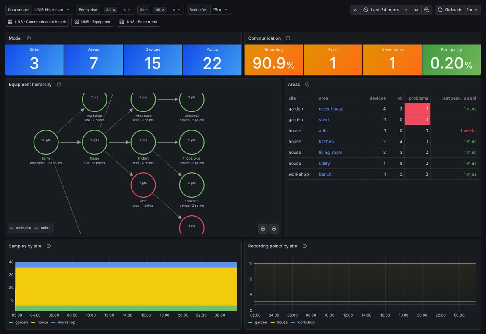
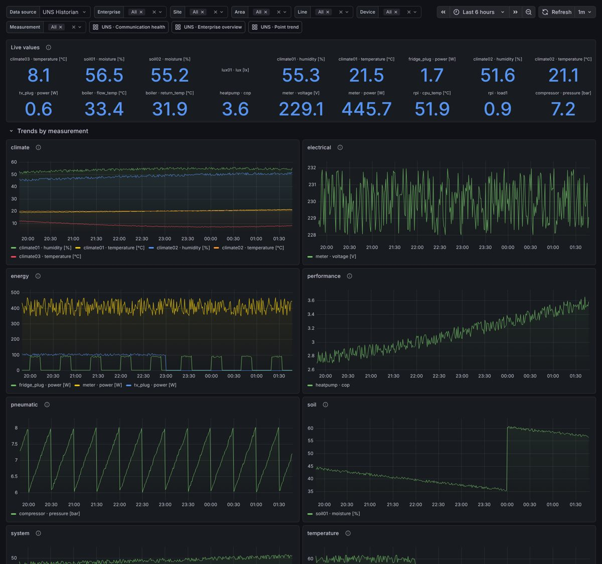
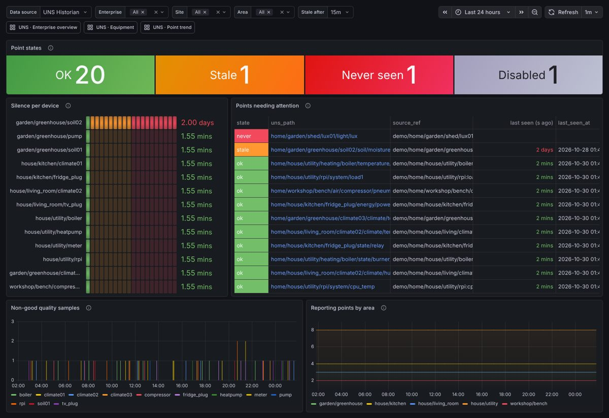

# UNS Dashboard

Grafana dashboards for a **Unified Namespace** organised along the **ISA-95** equipment
hierarchy (enterprise › site › area › line › device), backed by TimescaleDB and built
to run in Docker on a Raspberry Pi.

The dashboards never query your tables directly. They read a small, fixed **`uns`
contract schema**, and an **adapter** maps each source schema onto it. The first adapter
covers the MUTHUR historian schema (`historian.points` + `historian.readings`, see
[`db/source/muthur_historian.sql`](db/source/muthur_historian.sql)). To support another
schema you write one adapter file; the dashboards stay the same.

```
 MQTT ─► Node-RED ─► historian.points / historian.readings / readings_1h   (your schema)
                                  │
                     db/uns/adapters/muthur_historian.sql                  (mapping, views only)
                                  │
             uns.points · uns.readings · uns.readings_1h                   (contract)
                                  │
     db/uns/core.sql: uns.latest · uns.trend() · uns.point_health() · uns.hierarchy
                                  │
                         Grafana dashboards (grafana/dashboards/*.json)
```

## Dashboards

| Dashboard | What it answers |
|---|---|
| **UNS · Enterprise overview** | Model size, % of points reporting, bad-quality share, an interactive **node graph of the ISA-95 tree** (red = silent), per-area health table (click to drill down), ingest rate per site. |
| **UNS · Equipment** | Cascading enterprise › site › area › line › device › measurement filters. Live value tiles, one trend panel **per measurement** (auto-repeated), state timeline for `bool` points, point list with quality/age, asset attributes from the `attributes` jsonb (fw, ip, model…). |
| **UNS · Point trend** | Search any point by UNS path; avg with min/max envelope, statistics, good-quality %, newest raw samples. |
| **UNS · Communication health** | ok / stale / never / disabled counts, silence per device, problem points first, non-good OPC quality samples over time, reporting points per area. The "Stale after" picker sets the threshold. |





*(Screenshots use the bundled demo data.)*

All dashboards share a **Data source** picker and are cross-linked, so they keep the time range when you switch.

**Automatic resolution.** `uns.trend()` reads raw readings for short ranges and switches to
the hourly continuous aggregate for buckets ≥ 1 h or ranges ≥ 7 days. Raw data fills in the
last hour or so that the rollup hasn't materialised yet, and a bucket that spans both
sources is merged with sample-weighted averages. A 1-year chart on the Pi stays fast.

## Quick start: demo on any machine

```bash
cp .env.example .env
sed -i 's/^UNS_PG_HOST=.*/UNS_PG_HOST=demo-db/' .env
docker compose --profile demo up -d --wait
# http://localhost:3000  (admin / change-me)
```

The `demo` profile starts its own TimescaleDB. It loads the historian schema and 14 days
of synthetic 1-minute data (a house, garden and workshop, including a sensor with a dead
battery, one that never reported and a disabled one). It also runs a feed that writes a
new sample every minute. Remove it with `docker compose --profile demo down -v`.

## Raspberry Pi setup (your existing TimescaleDB)

1. **Install the uns layer** in your historian database. It only creates views and
   functions in schema `uns` and never touches `historian.*`:
   ```bash
   PSQL="docker exec -i timescaledb psql -U postgres -d home_data" tools/install_uns.sh
   ```
   Re-running it is safe: it rebuilds `uns` in one transaction.

2. **Give Grafana a password** for the read-only role the schema created:
   ```bash
   docker exec -it timescaledb psql -U postgres -c "ALTER ROLE grafana PASSWORD 'something-long'"
   ```

3. **Configure** `cp .env.example .env` and set `GRAFANA_ADMIN_PASSWORD`, `UNS_PG_PASSWORD`,
   and how Grafana reaches the database (`UNS_PG_HOST`):
   - TimescaleDB publishes port 5432 on the Pi → keep `host.docker.internal`.
   - TimescaleDB is on its own docker network → `UNS_PG_HOST=timescaledb` and copy
     `compose.override.example.yml` to `compose.override.yml` with that network's name.

4. `docker compose up -d`, then open `http://<pi>:3000`.

Both images are multi-arch (arm64), and Grafana uses about 100–150 MB of RAM.

## Continuous deployment with a self-hosted runner

- **`ci.yml`** runs on GitHub-hosted runners for every PR and push. It checks that the
  dashboard JSON matches the generator and lints the shell scripts. Then it boots the full
  demo stack and runs **every panel query** against it as the read-only `grafana` role,
  over a 6 h raw range and a 14-day rollup range. Last, it checks that Grafana provisioned
  the data source and all dashboards.
- **`deploy.yml`** runs on the Pi's runner (labels `self-hosted, linux, ARM64`) after CI
  passes on `main`, or manually. It rsyncs the repo to `DEPLOY_DIR` (default
  `~/uns-dashboard`) and runs `docker compose up -d --wait`. The manual run has options to
  re-install the uns schema and to start the demo profile.

Runner setup on the Pi:

1. Repo → Settings → Actions → Runners → *New self-hosted runner* → Linux / ARM64, and
   follow the commands. Then install it as a service: `sudo ./svc.sh install && sudo ./svc.sh start`.
2. Let the runner user use Docker (`sudo usermod -aG docker <runner-user>`) and install
   `rsync` (`sudo apt install rsync`).
3. Create `~/uns-dashboard/.env` once (step 3 above). Deploys never overwrite it.
4. Optional repository **variables**: `DEPLOY_DIR`, `TIMESCALE_CONTAINER` (default
   `timescaledb`), `PG_ADMIN_USER` (default `postgres`), `UNS_ADAPTER`.

> Security: a self-hosted runner executes workflow code on your Pi. Only `deploy.yml`
> targets it, and only for `main` or manual runs. If the repo is public, also set
> *Settings → Actions → Fork pull request workflows* to require approval.

## Supporting another schema

1. Copy `db/uns/adapters/_template.sql` to `db/uns/adapters/<name>.sql` and map your
   tables onto the three contract views. The template documents every column. A source
   without a rollup can return an empty `uns.readings_1h`.
2. `ADAPTER=<name> tools/install_uns.sh` against that database.
3. To show several databases side by side, add a data source per database in
   `grafana/provisioning/datasources/uns.yaml` and switch with the **Data source** picker.

The hierarchy levels are never NULL in the contract (`'(none)'` instead), so multi-select
filters keep matching devices that skip a level (e.g. no line). Those levels are also
skipped in the node graph and in `uns_path`.

## Editing dashboards

The JSON in `grafana/dashboards/` is generated from `tools/build_dashboards.py`, and
provisioned dashboards can't be saved from the UI. Change the Python file, then run:

```bash
python3 tools/build_dashboards.py                     # regenerate JSON
PGHOST=localhost PGPORT=55432 PGUSER=grafana PGPASSWORD=... PGDATABASE=home_data \
  python3 tools/check_queries.py --require-rows       # run every panel query
```

Grafana reloads the files within 30 s. To try something in the UI first, use *Save as*
to make a copy outside the UNS folder.

## Layout

```
db/source/muthur_historian.sql      your historian schema (reference + demo)
db/uns/adapters/*.sql               source schema → uns contract
db/uns/core.sql                     schema-independent helpers used by the dashboards
db/demo/                            demo data + demo-db init hook
grafana/provisioning/               data source + dashboard provider
grafana/dashboards/*.json           generated dashboards
tools/install_uns.sh                install/refresh the uns layer
tools/build_dashboards.py           dashboard generator
tools/check_queries.py              runs every panel query against a database
```
